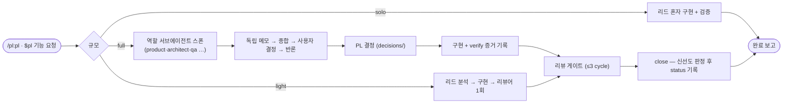

<div align="center">

# pl

**`/pl:pl`(Claude Code) 또는 `$pl`(Codex CLI) 한 번으로 역할 서브에이전트가 토론하고, 구현하고, 검증하고, 결정을 레포에 남깁니다**


</div>

---

PL/테크리드 오케스트레이션 플러그인입니다. 기능 요청을 받으면 리드(PL)가 작업 규모를 정하고, 역할 서브에이전트를 띄워 구조화된 토론을 거쳐 결정하고, 구현·검증 후 결과와 결정을 **레포 안 `docs/pl/`** 에 markdown으로 남깁니다. 기록은 코드와 같은 커밋·PR로 팀이 공유하고, 다음 작업에서 그대로 복원됩니다.

## 워크플로우



- **solo**: 파일 1개, 새 파일·테스트·동작 변경 없음 → 노트 없이 바로 처리.
- **light**: 파일 ≤ 3, 새 공개 API·스키마·외부 연동 없음 → 리드가 분석·구현하고 code reviewer가 한 번 본다.
- **full**: 그 외 → 분석 역할(product analyst·architect·QA) → 구현 역할 → 리뷰 역할. 요청에 `light`/`full`을 적으면 그 단계로 강제된다.

## 설치

> **전제조건**: macOS/Linux + `python3` 3.9 이상(런타임 헬퍼·훅; macOS 기본 `python3`로 충분) + `git`. 개발자만 `python3.11`(Codex 에이전트 생성기). 호스트는 Claude Code 또는 Codex CLI 0.153 이상. 마켓플레이스 접근 조건은 [루트 README](../../README.md#설치) 참조.

**Claude Code**

```
/plugin marketplace add zz1996zz/agent-plugins
/plugin install pl@zz1996zz
```

**Codex CLI**

```
codex plugin marketplace add zz1996zz/agent-plugins
codex plugin add pl@zz1996zz
bash "$(ls -d "${CODEX_HOME:-$HOME/.codex}"/plugins/cache/zz1996zz/pl/*/ | sort -V | tail -1)install-codex.sh"
# codex 에서 /hooks 로 pl 훅 신뢰 (1회)
```

세 번째 줄이 필요한 이유: Codex 플러그인은 skills·hooks는 번들하지만 역할 에이전트 정의는 번들하지 못합니다 ([openai/codex#18988](https://github.com/openai/codex/issues/18988)). `install-codex.sh`가 `agents/codex/*.toml`을 `~/.codex/agents/`에 복사합니다(`--prune`으로 옛 역할 정리, `--force`로 덮어쓰기). 훅이 발동하지 않으면 `~/.codex/config.toml`에 `[features] hooks = true`를 확인하세요.

## 사용

```
/pl:pl <기능 요청>        (Claude Code)
$pl <기능 요청>           (Codex CLI)
```

예: `/pl:pl 주문 취소 API에 부분 취소 지원 추가` · `/pl:pl light 로그 포맷에 요청 ID 추가`

- 역할 세션은 리드 모델을 그대로 상속하므로 비용과 요청 한도는 리드 모델 선택(`claude --model …`, `codex -m …`)으로 통제합니다. 역할마다 `maxTurns`가 있어 폭주하지 않습니다.
- 분석 단계에서 나온 **제품 범위 결정은 한 번에 모아 사용자에게 묻습니다.** 기술 결정은 리드가 합니다.
- `done`은 리드가 `pl_history.py verify`로 돌린 검증 명령이 **최종 코드 변경 뒤에** 모두 통과했을 때만 `close`가 허용합니다. 역할 세션의 "테스트 통과" 주장은 증거가 아닙니다.

## 히스토리 (레포 안 `docs/pl/`)

레포에서 작업하면 기록은 **작업트리의 `docs/pl/`** 에 생깁니다(팀 설정으로 위치 변경 가능). pl은 커밋하지 않습니다 — 코드와 함께 사용자가 커밋합니다.

```text
docs/pl/
  features/2026-10-20-partial-cancel.md   요청·범위·역할별 의견·종합·반론·결정·검증·리뷰·완료
  decisions/2026-10-20-use-queue.md       결정 1건 = 노트 1개 (대체되면 superseded 로 표시, 삭제 안 함)
  architecture.md                         현재 구조 메모
  .runtime/                               git 제외 — 실행 원장·검증 증거·역할 메모·리뷰 diff
```

- INDEX 파일이 없고 파일명이 `날짜-슬러그`라서 **병렬 브랜치가 머지 충돌을 내지 않습니다.** 목록은 `pl_history.py list`.
- 역할별 의견은 **요약**으로 남습니다(입장·근거·권고·열린 질문). 원문 대화록·비밀값·명령 출력은 커밋되지 않습니다.
- 레포 밖에서 쓰면 `~/.local/share/pl/history/<work>/`에 저장됩니다(`XDG_DATA_HOME` 존중). 위치를 옮기려면 플러그인 데이터 디렉터리의 `config.json`에 `{"historyRoot": "<절대경로>"}`.
- 0.4.x의 Obsidian vault / Notion 기록은 자동 이전하지 않습니다. 옮기려면 vault의 `work/<slug>/features/*.md`·`decisions/*.md`를 `docs/pl/features/`·`docs/pl/decisions/`로 복사하면 됩니다(INDEX는 불필요). Notion은 페이지를 markdown으로 내보내 같은 위치에 두세요.

## 레포 설정

| 파일 | 소유 | 커밋 | 키 |
|---|---|---|---|
| `.agents/pl.md` | 팀 | 예 | `historyDir`(기본 `docs/pl`), `verifyCommands`, `protectedPaths` |
| `.agents/pl.local.md` (권장) / `.claude/pl.local.md` (기존) | 개인 | 아니오 | `verifyCommands`, `protectedPaths` — 팀 목록에 **추가**만 된다 |

```markdown
---
historyDir: docs/pl               # 레포 루트 기준 상대경로. 절대경로·.. 탈출·.git 아래는 거부
verifyCommands:                   # done 전에 반드시 통과해야 하는 명령 (철회 불가)
  - ./gradlew test
protectedPaths:                   # 역할 세션은 절대, 리드는 명시 요청 시에만 편집
  - infra/
  - .github/
---
```

리드는 두 파일을 읽기만 하고 만들거나 고치지 않습니다. 개인 파일의 `historyDir`·`workNamespace`는 무시됩니다(경고 1회).

## 안전 훅

`hooks/guard.py`(PreToolUse)가 아래를 차단합니다. pl의 안전 경계("되돌릴 수 없는 행동은 사람 손에")를 기계적으로 지키기 위한 것입니다.

| 차단 | 예 |
|---|---|
| force-push | `git push --force`, `-f`, `--force-with-lease`, `+main`·`:branch` refspec, `--delete`, `--mirror` |
| hard reset | `git reset --hard`(`--har` 같은 축약 포함) |
| 미커밋 변경 폐기 | `git restore <path>`, `git checkout -- <path>`, `checkout -f`, `switch -f`, `--pathspec-from-file` |
| 추적되지 않은 파일·복구 이력 삭제 | `git clean -f`, `rm -rf .git`, `git rm -rf .`, `update-ref -d`, `reflog expire`, `gc --prune`, `worktree remove --force` |
| 검사·별칭 우회 | `--no-verify`, `commit -n`, `-c core.hooksPath=…`, `--config-env`, `GIT_CONFIG_PARAMETERS`, `git config core.hooksPath`, `-c alias.*` |
| 보관·브랜치 강제 삭제 | `git stash drop`/`clear`, `git branch -D` |

- **커밋·push 자체는 막지 않습니다** — 훅은 사용자가 그걸 요청했는지 알 수 없습니다.
- 셸 문법을 이해합니다: `env git …`, `sh -c "…"`, `xargs`, `$( )`, 백슬래시 개행은 판정하고, 커밋 메시지·heredoc 본문·리다이렉션(`2>&1`)은 명령으로 보지 않습니다.
- 해제 옵션은 없습니다. 정말 필요하면 프롬프트에 `! <명령>`으로 직접 실행하세요.

**적용 범위** — pl을 쓰지 않는 세션에는 영향이 없습니다.

| 호스트 | 리드 | 역할 세션 |
|---|---|---|
| Claude Code | `/pl:pl`을 실행한 순간부터 그 세션이 끝날 때까지(스킬 frontmatter 훅) | 항상(플러그인 훅이 `agent_type`이 `pl:team-pl-*`일 때만 판정) |
| Codex CLI | 항상(플러그인 훅; 스킬 단위 훅이 없음) | 항상 |

Codex에서는 새 플러그인 훅을 처음 한 번 `/hooks`에서 신뢰해야 합니다. 판정은 `tests/pl-guard/run-unit.sh`(121케이스)로 고정됩니다.

## 호스트 차이

역할 세션은 두 호스트 모두 **일반 서브에이전트**입니다. 메모는 세션의 최종 응답이고, 반론·재리뷰는 리드가 agent ID로 재개해 보냅니다. 역할끼리 직접 대화하지 않습니다.

| | Claude Code | Codex CLI |
|---|---|---|
| 스폰 | `Agent`(`pl:team-pl-<role>`, `name` 없음) | `spawn_agent`(`team-pl-<role>`) |
| 재개 / 중지 | `SendMessage` / `TaskStop` | `send_input`·`resume_agent` / `close_agent` |
| 역할 메모 저장 | 플러그인 SubagentStop 훅이 `pl:team-pl-*` 세션의 메모를 `.runtime/<feature>/memos/`에 자동 저장(다른 에이전트에는 아무 동작 없음) | 리드가 기록 |
| 역할별 허용 도구 | 에이전트 `tools` 목록(`maxTurns`, 검사 역할 `effort: xhigh`) | TOML의 `sandbox_mode`는 **적용되지 않는다**(공식 문서; 부모 세션 샌드박스가 적용). 읽기 전용 규칙은 `developer_instructions` 산문 |
| 역할 정의 설치 | 플러그인에 번들 | `install-codex.sh`로 `~/.codex/agents/`에 복사 |
| Agent Teams | 켜 둔 사용자도 동작합니다(이름 없는 스폰은 teammate로 바뀌지 않음). 끄기를 권장: `CLAUDE_CODE_EXPERIMENTAL_AGENT_TEAMS=0` | 해당 없음 |
| 진입점 | `disable-model-invocation`으로 `/pl:pl` 명시 호출만 | description 기반 암묵 호출 허용 |

## 추천 조합 (선택)

pl은 단독으로 완결입니다. Claude Code에서는 아래와 자연스럽게 합성됩니다 — **없으면 pl이 자동으로 무시합니다.**

| 플러그인 | 합성 효과 |
|---|---|
| `context7` | 라이브러리 버전별 최신 문서 MCP — 설치돼 있으면 리드가 필요 시 활용 |
| [`codebase-memory-mcp`](https://github.com/DeusData/codebase-memory-mcp) | 코드 지식 그래프 MCP — 설치돼 있으면 리드가 파일 탐색 대신 구조 쿼리를 우선 사용 |
| `security-guidance` | 편집·커밋 시 자동 보안 경고 훅 — 역할 세션의 편집에도 적용 |

## 업데이트

```
/plugin marketplace update zz1996zz
/plugin update pl@zz1996zz
```

Codex CLI: `codex plugin marketplace upgrade` → `codex plugin remove pl@zz1996zz && codex plugin add pl@zz1996zz` → `install-codex.sh --force --prune`.

히스토리는 레포 안에 있으므로 플러그인 업데이트·삭제의 영향을 받지 않습니다. 플러그인 데이터 디렉터리에는 로컬 모드 `config.json`만 있습니다.

## 개발

테스트 매트릭스와 변경 수칙은 [`CONTRIBUTING.md`](../../CONTRIBUTING.md)에 있습니다. 프롬프트 문서(`SKILL.md`·`references/`·`agents/`)를 고쳤으면 실제 세션 E2E([`tests/pl-e2e/README.md`](../../tests/pl-e2e/README.md))까지 돌립니다.
