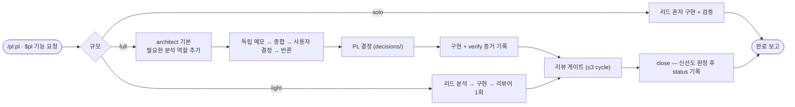

<div align="center">

# pl

**`/pl:pl`(Claude Code) 또는 `$pl`(Codex CLI) 한 번으로 역할 서브에이전트가 토론하고, 구현하고, 검증하고, 결정을 레포에 남깁니다**


</div>

---

Claude Code·Codex CLI용 PL/테크리드 오케스트레이션 플러그인입니다. 기능 요청을 받으면 리드(PL)가 작업 규모를 정합니다. 단순 수정은 리드가 처리하고, `light`는 구현 후 리뷰, `full`은 역할별 분석·토론·구현·리뷰를 거칩니다. `light`·`full`의 결과와 결정은 기본적으로 **레포 안 `docs/pl/`** 에 Markdown으로 남겨 코드와 함께 공유하고 다음 작업에서 참조합니다.

## 워크플로우



- **solo**: 파일 1개, 새 파일·테스트·동작 변경 없음 → 노트 없이 바로 처리.
- **light**: 범위·수용 조건이 명확하고 기존 패턴과 검증으로 처리할 수 있는 기본 경로 → 리드 분석·구현(또는 engineer 한 명) → code reviewer. 파일 수만으로 full을 강제하지 않는다.
- **full**: 새 계약 설계, 권한·데이터 보존·롤백 위험의 선행 분석, 미정 의존성이 필요한 경우 → architect 기본 분석 → 구현 → 리뷰. 미결정 제품 범위가 있으면 product, 설계 전에 검증 전략이 필요하면 QA를 추가한다. 요청에 `light`/`full`을 적으면 그 단계를 따른다.

애매하면 light로 시작하고 구체적인 위험을 발견하면 full로 승격합니다. 단계별 예정 세션 수와 각 추가 세션의 독립 질문·산출물을 기록하며, 같은 조사를 역할별로 반복하지 않습니다. reviewer와 검증 신선도 기준은 두 경로 모두 유지합니다.

## 설치

> **전제조건**: macOS/Linux + `python3` 3.9 이상(런타임 헬퍼·훅) + `git`. Codex 에이전트 생성기를 실행하는 개발자는 Python 3.11 이상이 필요합니다. 호스트는 플러그인·서브에이전트를 지원하는 Claude Code 또는 Codex CLI입니다. 설치·업데이트 명령은 Claude Code 2.1.316 / Codex CLI 0.166.0에서 확인했습니다. 계정·조직 정책에 따라 플러그인이나 도구 사용이 제한될 수 있습니다.

**Claude Code**

```text
/plugin marketplace add zz1996zz/agent-plugins
/plugin install pl@zz1996zz
```

Claude Code 세션에서 실행한 뒤 설치 화면에서 범위를 선택해 확인합니다. 터미널에서는 `claude plugin marketplace add zz1996zz/agent-plugins`와 `claude plugin install pl@zz1996zz`를 사용할 수 있습니다.

**Codex CLI**

```bash
codex plugin marketplace add zz1996zz/agent-plugins
codex plugin add pl@zz1996zz
```

설치 후 Codex 세션의 `/hooks`에서 현재 안전 command hook 정의를 검토하고 신뢰합니다. 새로 설치했거나 정의가 바뀐 hook은 신뢰 전까지 실행되지 않습니다. [공식 hook 신뢰 안내](https://learn.chatgpt.com/docs/hooks#review-and-trust-hooks)

개인 agent 설치 없이 사용할 수 있습니다. PL은 번들 `agents/team-pl-*.md`의 역할 본문과 shared preamble을 일반 subagent brief에 전달합니다. 호스트가 custom `agent_type`을 노출하고 해당 역할이 로드된 경우에는 이름으로 선택할 수도 있습니다. 이 선택 경로에만 `bash <설치된 plugin 경로>/install-codex.sh`를 사용합니다. 기존 개인 TOML과 충돌하면 자동으로 덮어쓰지 않습니다. 모델·effort는 Codex의 `[agents]` 기본값 등 외부 config가 결정하며 PL은 override하지 않습니다. [공식 subagent 문서](https://learn.chatgpt.com/docs/agent-configuration/subagents)

Codex의 skill frontmatter hook과 Claude `Skill` 도구에 의존하지 않습니다. command hook을 신뢰하지 않았거나 실행 환경이 지원하지 않아도 lead가 memo를 저장하고 `verify`·리뷰·`close`를 직접 수행합니다. prompt·agent hook handler는 건너뛸 수 있으므로 핵심 작업에 사용하지 않습니다. [공식 hook 설정](https://learn.chatgpt.com/docs/config-file/config-reference)

## 사용

```
/pl:pl <기능 요청>        (Claude Code)
$pl <기능 요청>           (Codex CLI)
```

예: `/pl:pl 주문 취소 API에 부분 취소 지원 추가` · `/pl:pl light 로그 포맷에 요청 ID 추가`

- Claude는 번들 역할 정의의 모델·effort를 사용합니다. 판정 역할은 `opus`/`high`, 생산 역할과 QA는 `sonnet`/`high`, product-analyst는 `sonnet`/`medium`입니다. Codex 역할의 모델·effort는 외부 config의 일반 subagent 기본값을 따릅니다.
- PL 역할에는 고정 턴 상한을 두지 않습니다. 정상적으로 진행 중인 작업은 완료 조건까지 수행하고, 반복 실패·정체·외부 의존성으로 막히면 시도한 내용과 원인을 리드에게 보고합니다. 호스트 자체의 사용량·실행 제한은 적용됩니다.
- 여러 독립 기능은 같은 역할을 여러 명 배정할 수 있습니다. 예를 들어 주문·검색을 `pl-backend-orders`·`pl-backend-search`가 각각 맡습니다. frontend·data·QA·리뷰·보안·통합·제품 분석·설계 역할도 scope별로 나눌 수 있습니다. 공통 계약을 먼저 맞추고 파일 소유권과 원장 항목을 분리하며, 공통 파일 수정은 순차 통합합니다. 분할 리뷰 뒤 전체 diff의 기능 간 상호작용을 검토하고 리드가 통합 검증합니다. 기능 수만큼 모든 역할을 복제하지는 않습니다.
- 분석 단계에서 나온 **제품 범위 결정은 한 번에 모아 사용자에게 묻습니다.** 기술 결정은 리드가 합니다.
- `done`은 리드가 `pl_history.py verify`로 돌린 검증 명령이 **최종 코드 변경 뒤에** 모두 통과했을 때만 `close`가 허용합니다. 역할 세션의 "테스트 통과" 주장은 증거가 아닙니다.

## 히스토리 (레포 안 `docs/pl/`)

레포에서 `light`·`full` 작업을 하면 기록은 **작업트리의 `docs/pl/`** 에 생깁니다(팀 설정으로 위치 변경 가능). `solo`는 기록을 만들지 않습니다. pl은 명시적인 요청 없이 커밋·푸시하지 않습니다. 기록은 코드와 함께 검토해 커밋할 수 있습니다.

```text
docs/pl/
  features/2026-10-20-partial-cancel.md   요청·범위·역할별 의견·종합·반론·결정·검증·리뷰·완료
  decisions/2026-10-20-use-queue.md       결정 1건 = 노트 1개 (대체되면 superseded 로 표시, 삭제 안 함)
  architecture.md                         현재 구조 메모
  .runtime/                               git 제외 — 실행 원장·검증 증거·역할 메모·리뷰 diff (모두 pl_history.py 가 기록)
```

- 공용 INDEX 파일을 두지 않고 `날짜-슬러그`별 노트를 만들어 **서로 다른 작업의 머지 충돌을 줄입니다.** 같은 노트나 `architecture.md`를 함께 수정하면 충돌할 수 있습니다. 목록은 `pl_history.py list`로 확인합니다.
- 역할별 의견은 **요약**으로 남습니다(입장·근거·권고·열린 질문). 원문 대화록·비밀값·명령 출력은 커밋되지 않습니다.
- 같은 단계의 원장 행·spawn 기록은 `pl_history.py ledger batch`로 묶습니다. `close`가 기록된 세션의 `Team:`을 생성하며, 완료 memo 근거가 없는 세션을 정상 완료로 세지 않습니다. 기존 단일 기록 명령도 지원합니다.
- 레포 밖에서 쓰면 `~/.local/share/pl/history/<work>/`에 저장됩니다(`XDG_DATA_HOME` 존중). 위치를 옮기려면 플러그인 데이터 디렉터리의 `config.json`에 `{"historyRoot": "<절대경로>"}`.
- 0.4.x의 Obsidian vault / Notion 기록은 자동 이전하지 않습니다. 옮기려면 vault의 `work/<slug>/features/*.md`·`decisions/*.md`를 `docs/pl/features/`·`docs/pl/decisions/`로 복사하면 됩니다(INDEX는 불필요). Notion은 페이지를 markdown으로 내보내 같은 위치에 두세요.

## 레포 설정

| 파일 | 소유 | 커밋 | 키 |
|---|---|---|---|
| `.agents/pl.md` | 팀 | 예 | `historyDir`(기본 `docs/pl`), `verifyCommands`, `protectedPaths` |
| `.agents/pl.local.md` (권장) / `.claude/pl.local.md` (기존) | 개인 | 아니오 | `verifyCommands`, `protectedPaths` — 팀 목록에 **추가**만 된다 |

```markdown
---
historyDir: docs/pl               # 레포 루트 기준 상대경로. 절대경로·.. 탈출·.git 아래는 거부
verifyCommands:                   # done 전에 반드시 통과해야 하는 명령 (철회 불가)
  - ./gradlew test
protectedPaths:                   # 역할 세션은 절대, 리드는 명시 요청 시에만 편집
  - infra/
  - .github/
---
```

리드는 두 파일을 읽기만 하고 만들거나 고치지 않습니다. 개인 파일의 `historyDir`·`workNamespace`는 무시됩니다(경고 1회).

## 안전 훅

`hooks/guard.py`(PreToolUse)가 아래를 차단합니다. pl의 안전 경계("되돌릴 수 없는 행동은 사람 손에")를 기계적으로 지키기 위한 것입니다.

| 차단 | 예 |
|---|---|
| force-push | `git push --force`, `-f`, `--force-with-lease`, `+main`·`:branch` refspec, `--delete`, `--mirror` |
| hard reset | `git reset --hard`(`--h`·`--ha`·`--har` 축약 포함) |
| 미커밋 변경 폐기 | `git restore <path>`, `git checkout -- <path>`, `checkout -f`, `switch -f`, `--pathspec-from-file` |
| 추적되지 않은 파일·복구 이력 삭제 | `git clean -f`, `rm -rf .git`, `git rm -rf .`, `update-ref -d`, `reflog expire`, `gc --prune`, `worktree remove --force` |
| 검사·별칭 우회 | `--no-verify`, `commit -n`, `-c core.hooksPath=…`, `--config-env`, `GIT_CONFIG_PARAMETERS`, `git config core.hooksPath`, `-c alias.*` |
| 보관·브랜치 강제 삭제 | `git stash drop`/`clear`, `git branch -D` |

- **커밋·push 자체는 막지 않습니다** — 훅은 사용자가 그걸 요청했는지 알 수 없습니다.
- `env git …`, `sh -c "…"`, `xargs`, `$( )`, 백슬래시 개행 같은 입력을 분석하며, 테스트된 커밋 메시지·heredoc 본문·리다이렉션(`2>&1`)을 명령과 구분합니다. 전체 셸 실행을 추적하는 sandbox는 아니며, 임의 스크립트 내부의 모든 동작을 검사하지는 않습니다.
- 해제 옵션은 없습니다. 차단된 명령을 정말 실행해야 한다면 사용자가 직접 터미널에서 실행합니다.
- 내부 예외가 나면 훅은 실행을 허용합니다(`fail open`). 훅만으로 모든 파괴적 명령이 차단된다고 보장하지 않습니다.

**적용 범위** — Claude는 PL 세션 범위이고, Codex plugin hook은 신뢰 후 다른 세션에도 적용됩니다. hook 미실행 시 기계적 차단을 보장하지 않습니다.

| 호스트 | 리드 | 역할 세션 |
|---|---|---|
| Claude Code | PL 스킬 로드 후 세션의 `Bash` 호출(스킬 frontmatter 훅) | 플러그인 훅이 실행되고 `agent_type`이 `pl:team-pl-*`인 `Bash` 호출 |
| Codex CLI | 신뢰한 플러그인 훅이 실행되는 `Bash` 호출. PL 호출 여부로 제한되지 않음 | 같은 조건 |

Codex에서는 새 플러그인 hook 정의를 `/hooks`에서 신뢰해야 합니다. 판정은 `tests/pl-guard/run-unit.sh`로 검증합니다.

## 호스트 차이

역할 세션은 두 호스트 모두 **일반 서브에이전트**입니다. 메모는 세션의 최종 응답이고, 반론·재리뷰는 리드가 agent ID로 재개해 보냅니다. 역할끼리 직접 대화하지 않습니다.

| | Claude Code | Codex CLI |
|---|---|---|
| 스폰 | `Agent`(`pl:team-pl-<role>`, `name` 없음) | 실제 schema에 맞는 `spawn_agent`; 역할 본문 전달 또는 지원되는 custom type. 필수 `task_name` 전달 |
| 재개 / 중지 | `SendMessage` / `TaskStop` | CLI: `send_input`·`resume_agent` / `close_agent`; collaboration: `followup_task` / `interrupt_agent` |
| 역할 메모 저장 | SubagentStop hook의 자동 저장은 보조 수단; 최종 응답이 원본 | lead가 `pl_history.py memo --feature <stem> --agent-id <id>`의 stdin에 수신 원문을 전달 |
| 역할별 허용 도구 | 에이전트 `tools` 목록(`model`, `effort`) | 부모 sandbox·도구 권한 적용. 역할 본문과 brief의 편집 제한은 산문 계약이며 강제 접근 제어가 아님 |
| 역할 정의 설치 | 플러그인에 번들 | 본문 전달은 설치 불필요. custom type 사용 시에만 개인 TOML 선택 설치 |
| Agent Teams | PL은 `name` 없는 일반 subagent를 사용합니다. 패널 차이를 사용자가 묻는 경우에만 설정을 안내합니다. | 해당 없음 |
| 진입점 | `disable-model-invocation`으로 `/pl:pl` 명시 호출만 | description 기반 암묵 호출 허용 |

## 추천 조합 (선택)

pl은 단독으로 완결입니다. Claude Code에서는 아래와 자연스럽게 합성됩니다 — **없으면 pl이 자동으로 무시합니다.**

| 플러그인 | 합성 효과 |
|---|---|
| `context7` | 라이브러리 버전별 최신 문서 MCP — 설치돼 있으면 리드가 필요 시 활용 |
| [`codebase-memory-mcp`](https://github.com/DeusData/codebase-memory-mcp) | 코드 지식 그래프 MCP — 설치돼 있으면 리드가 파일 탐색 대신 구조 쿼리를 우선 사용 |
| `security-guidance` | 편집·커밋 시 자동 보안 경고 훅 — 역할 세션의 편집에도 적용 |

## 업데이트

Claude Code 터미널:

```bash
claude plugin marketplace update zz1996zz
claude plugin update pl@zz1996zz
```

Codex CLI 터미널:

```bash
codex plugin marketplace upgrade zz1996zz
codex plugin remove pl@zz1996zz && codex plugin add pl@zz1996zz
```

새 세션에서 갱신된 스킬을 사용합니다. Claude Code는 `/reload-plugins`로도 적용할 수 있고, Codex에서 hook 재검토가 필요하면 `/hooks`로 확인합니다. 개인 custom agent를 사용하는 경우에만 기존 TOML과 새 생성본을 비교한 뒤 `install-codex.sh`로 갱신합니다. 예전 생성본에 남아 있는 `model_reasoning_effort = "xhigh"`는 사용자 기본값보다 우선할 수 있습니다.

히스토리는 레포의 `docs/pl/` 또는 레포 밖의 로컬 history 경로에 있어 플러그인 캐시와 분리됩니다. 플러그인 데이터 디렉터리는 로컬 모드 `config.json`에 사용합니다. Claude Code에서 설정까지 보존하며 삭제하려면 `claude plugin uninstall pl@zz1996zz --keep-data`를 사용합니다. 상세 삭제 범위는 [루트 README](../../README.md#업데이트)를 참조하세요.

## 개발

테스트 매트릭스와 변경 수칙은 [`CONTRIBUTING.md`](../../CONTRIBUTING.md)에 있습니다. 프롬프트 문서(`SKILL.md`·`references/`·`agents/`)를 고쳤으면 실제 세션 E2E([`tests/pl-e2e/README.md`](../../tests/pl-e2e/README.md))까지 돌립니다.
